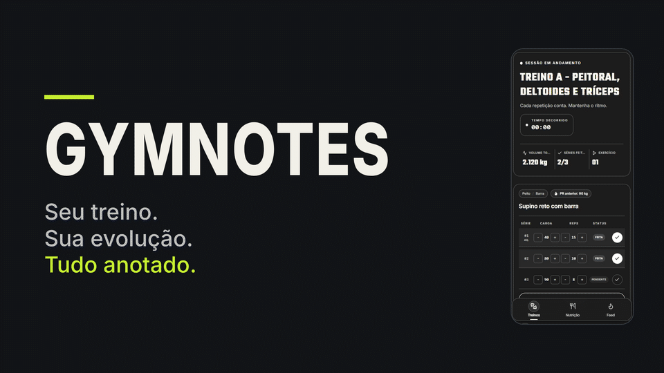
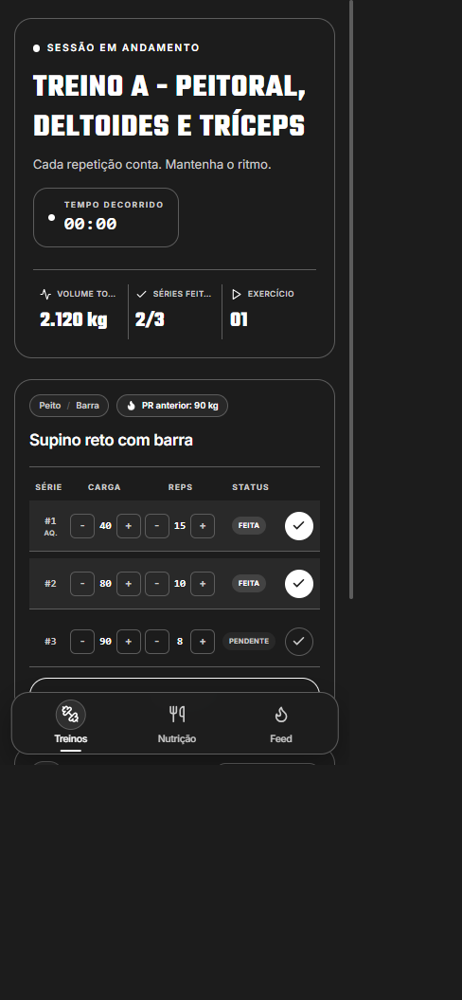
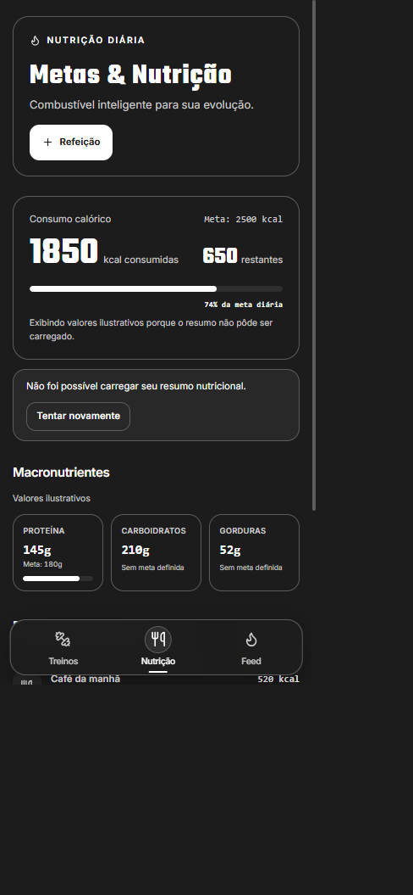
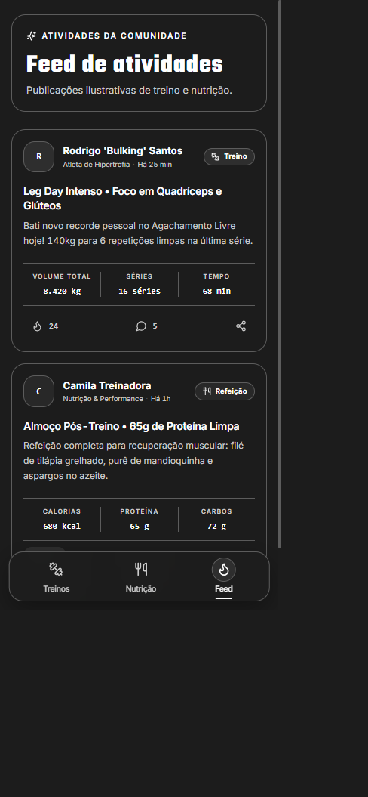

  

  <h1>Seu treino. Sua evolução. Tudo anotado.</h1>

  

    Treinos, cargas e nutrição em um só lugar — para você acompanhar o processo
    e manter o foco no que importa: continuar evoluindo.
  

  

    <a href="#o-que-você-encontra">Conheça o GymNotes</a>
  

---

## Menos anotações soltas. Mais clareza em cada sessão.

O **GYMNOTES** é um diário digital de treino e nutrição feito para tornar o
acompanhamento da sua rotina mais simples. Registre seu trabalho, consulte seus
dados e tenha as informações importantes à mão — no computador ou no celular.

## Conheça o GymNotes

## Por dentro do produto

<table>
  <tr>
    <td width="50%" align="center">
      
      <strong>Treinos</strong> 
      Registre cargas, repetições e acompanhe cada sessão.
    </td>
    <td width="50%" align="center">
      
      <strong>Nutrição</strong> 
      Consulte calorias, macronutrientes e refeições. Valores ilustrativos.
    </td>
  </tr>
  <tr>
    <td colspan="2" align="center">
      
      <strong>Feed de atividades</strong> 
      Acompanhe publicações de treinos e refeições.
    </td>
  </tr>
</table>

## O que você encontra

### Treinos com os detalhes que contam

- Registre exercícios, técnicas de série, carga e repetições; para cardio, duração e distância.
- Pesquise exercícios de máquinas e compostos por seus grupos musculares.
- Salve fichas com séries normais, drop set, bi-set, super set, tri-set, rest-pause e série gigante.
- Consulte o histórico, retome cargas anteriores e acompanhe a evolução.
- Ao finalizar, confira o resumo da sessão e escolha se quer publicá-la no feed.

### Nutrição sem complicação

- Registre refeições e consulte calorias e macronutrientes do dia.
- Pesquise alimentos no catálogo e confira os dados nutricionais disponíveis.

### Objetivo com acompanhamento de progresso

- Defina se quer emagrecer, crescer ou recompor o corpo, com peso-alvo e prazo quando aplicável.
- Informe quantos dias por semana planeja treinar e acompanhe as sessões realizadas.
- Consulte o histórico de peso, o consumo registrado e uma projeção estimada de ritmo e prazo.
- Na recomposição, acompanhe o ciclo e a consistência sem tratar a balança como única medida de progresso.

### Uma experiência feita para acompanhar sua rotina

- Navegação adaptada para celular e desktop.
- Interface escura, direta e pensada para o uso na academia.
- Contas com login por e-mail ou nome de usuário, amizades e feed de atividades.
