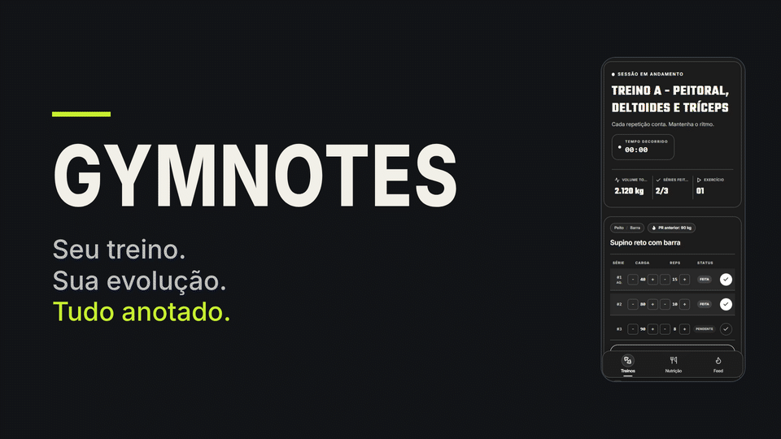
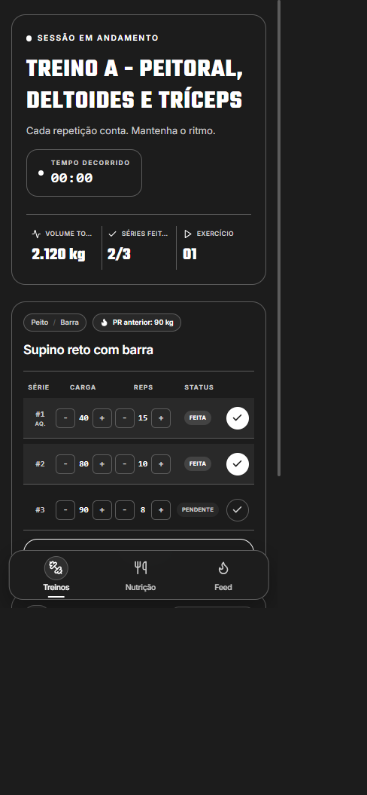
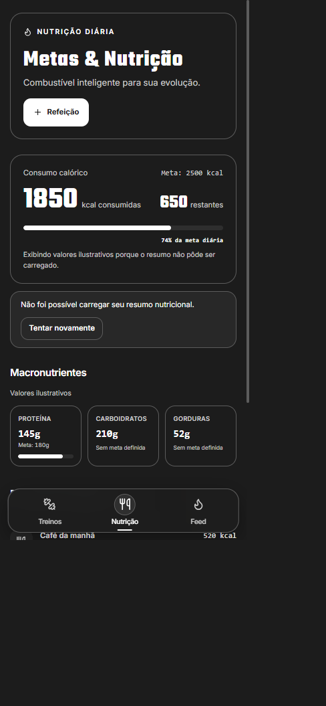
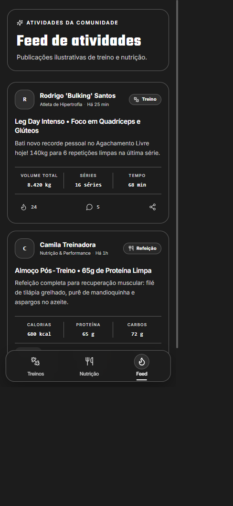

  

  <h1>Seu treino. Sua evolução. Tudo anotado.</h1>

  

    Treinos, cargas e nutrição em um só lugar — para você acompanhar o processo
    e manter o foco no que importa: continuar evoluindo.
  

  

    <a href="#o-que-você-encontra">Conheça o GymNotes</a>
  

---

## Menos anotações soltas. Mais clareza em cada sessão.

O **GYMNOTES** é um diário digital de treino e nutrição feito para tornar o
acompanhamento da sua rotina mais simples. Registre seu trabalho, consulte seus
dados e tenha as informações importantes à mão — no computador ou no celular.

## Conheça o GymNotes

## Por dentro do produto

<table>
  <tr>
    <td width="50%" align="center">
      
      <strong>Treinos</strong> 
      Registre cargas, repetições e acompanhe cada sessão.
    </td>
    <td width="50%" align="center">
      
      <strong>Nutrição</strong> 
      Consulte calorias, macronutrientes e refeições. Valores ilustrativos.
    </td>
  </tr>
  <tr>
    <td colspan="2" align="center">
      
      <strong>Feed de atividades</strong> 
      Acompanhe publicações de treinos e refeições.
    </td>
  </tr>
</table>

## O que você encontra

### Treinos com os detalhes que contam

- Registre exercícios, séries, repetições, carga e esforço.
- Salve fichas de treino com exercícios e séries planejadas.
- Consulte o histórico, retome cargas anteriores e acompanhe a evolução.
- Ao finalizar, confira o resumo da sessão e escolha se quer publicá-la no feed.

### Nutrição sem complicação

- Registre refeições e consulte calorias e macronutrientes do dia.
- Pesquise alimentos no catálogo e confira os dados nutricionais disponíveis.
- Defina um objetivo, acompanhe metas estimadas e registre seu peso ao longo do tempo.

### Uma experiência feita para acompanhar sua rotina

- Navegação adaptada para celular e desktop.
- Interface escura, direta e pensada para o uso na academia.
- Contas com login por e-mail ou nome de usuário, amizades e feed de atividades.

## Preparar para produção

O projeto é dividido entre a interface Next.js (`frontend`) e a API Spring Boot
(`backend`). A interface pode ser publicada na Vercel; a API precisa de um
serviço que execute a imagem Docker e de um PostgreSQL acessível por esse
serviço.

### Interface na Vercel

Crie um projeto Vercel apontando para este repositório e defina a pasta raiz
como `frontend`. Use a configuração detectada para Next.js e cadastre:

| Variável | Valor |
| --- | --- |
| `NEXT_PUBLIC_API_URL` | URL HTTPS pública da API, terminando em `/api/v1` |
| `BLOB_READ_WRITE_TOKEN` | Token de leitura e gravação do armazenamento Blob da Vercel |

Crie um armazenamento Blob no projeto Vercel antes de cadastrar o token. Fotos
de treinos publicados são enviadas ao Blob e ficam acessíveis publicamente,
como a própria publicação. Fotos de treinos não publicados permanecem no
histórico autenticado e não são enviadas ao armazenamento público.

### API e banco de dados

Publique `backend/Dockerfile` em uma plataforma de contêineres. A imagem ativa
o perfil `prod` e exige estas variáveis:

| Variável | Valor |
| --- | --- |
| `SPRING_DATASOURCE_URL` | URL JDBC completa do PostgreSQL |
| `DB_USER` | Usuário do banco |
| `DB_PASSWORD` | Senha do banco |
| `JWT_SECRET` | Segredo aleatório com pelo menos 32 bytes |
| `CORS_ALLOWED_ORIGINS` | Origens HTTPS permitidas, separadas por vírgula e sem barra final |
| `API_PUBLIC_URL` | Origem HTTPS pública da API, sem `/api/v1` |
| `PORT` | Porta informada pela plataforma, se diferente de `8080` |

Use um segredo JWT exclusivo e armazene todas as credenciais no gerenciador de
variáveis da plataforma, nunca no repositório. Configure `CORS_ALLOWED_ORIGINS`
com o domínio real da interface e, se necessário, seus domínios personalizados.

Flyway aplica as migrations ao iniciar a API. Em produção, a criação automática
de uma linha de referência para bancos existentes está desativada para evitar
marcar um esquema desconhecido como atualizado. Antes de publicar, faça backup
do banco e confirme o histórico de migrations; bancos existentes sem histórico
Flyway precisam ser avaliados e preparados antes da primeira inicialização.

### Verificações antes da publicação

Na pasta `frontend`, execute `npm ci`, `npm run lint`, `npm run build` e
`npm run test:live-smoke`. O teste de fumaça usa `GYMNOTES_WEB_URL` e
`GYMNOTES_API_URL`; configure essas variáveis para os endereços que deseja
verificar. Para testar localmente, a verificação de HTTPS é dispensada apenas
para endereços de loopback.

Na pasta `backend`, execute `mvn test`. Também confirme no painel da Vercel e
na plataforma da API que todas as variáveis estão configuradas, que a origem
da interface foi liberada no CORS e que o banco foi copiado antes da migração.
