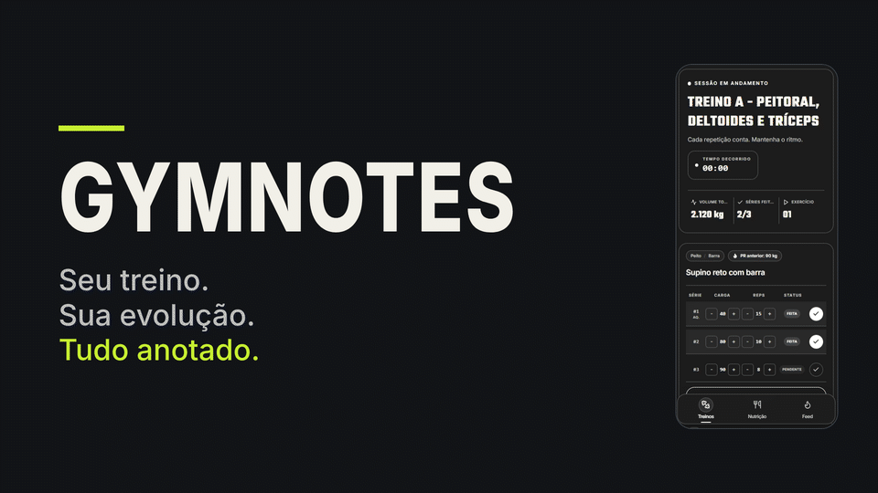
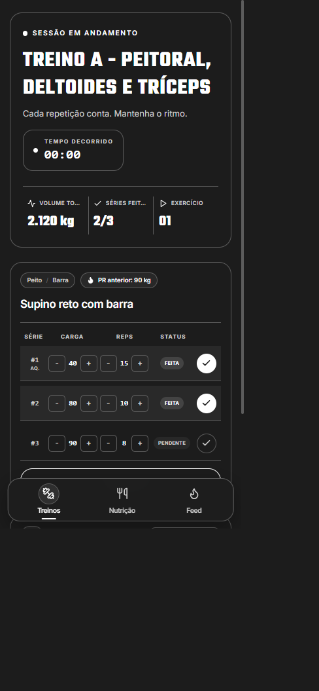
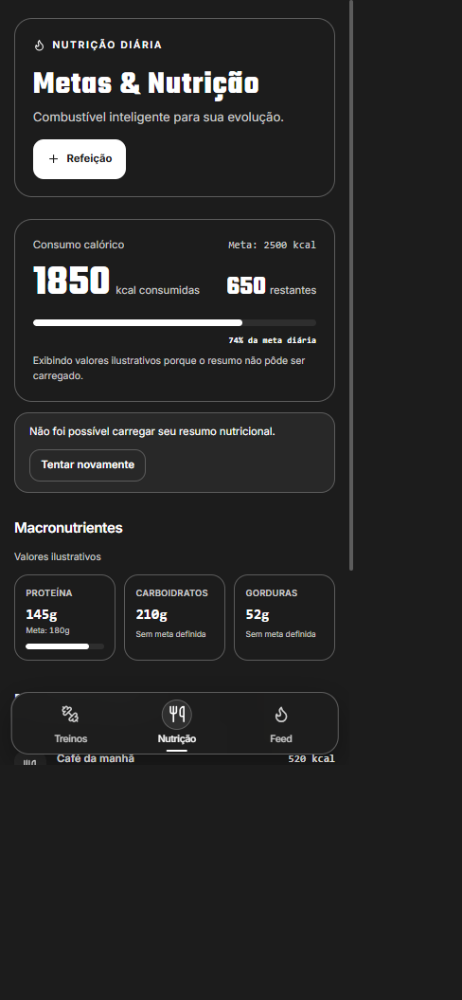
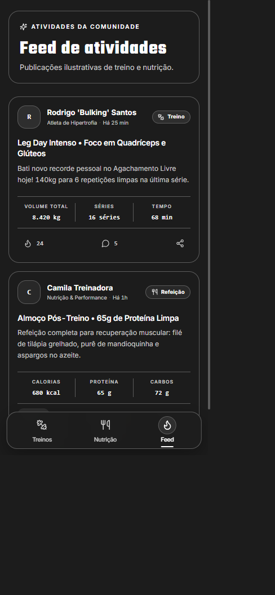

  

  <h1>Seu treino. Sua evolução. Tudo anotado.</h1>

  

    Treinos, cargas e nutrição em um só lugar — para você acompanhar o processo
    e manter o foco no que importa: continuar evoluindo.
  

  

    <a href="#o-que-você-encontra">Conheça o GymNotes</a>
  

---

## Menos anotações soltas. Mais clareza em cada sessão.

O **GYMNOTES** é um diário digital de treino e nutrição feito para tornar o
acompanhamento da sua rotina mais simples. Registre seu trabalho, consulte seus
dados e tenha as informações importantes à mão — no computador ou no celular.

## Conheça o GymNotes

## Por dentro do produto

<table>
  <tr>
    <td width="50%" align="center">
      
      <strong>Treinos</strong> 
      Registre cargas, repetições e acompanhe cada sessão.
    </td>
    <td width="50%" align="center">
      
      <strong>Nutrição</strong> 
      Consulte calorias, macronutrientes e refeições. Valores ilustrativos.
    </td>
  </tr>
  <tr>
    <td colspan="2" align="center">
      
      <strong>Feed de atividades</strong> 
      Acompanhe publicações de treinos e refeições.
    </td>
  </tr>
</table>

## O que você encontra

### Treinos com os detalhes que contam

- Registre exercícios, séries, repetições, carga e esforço.
- Acompanhe o histórico das sessões e a progressão dos exercícios pela API.
- Use o timer de descanso e visualize o volume da sessão durante o treino.

### Nutrição sem complicação

- Registre refeições e consulte calorias e macronutrientes do dia.
- Pesquise alimentos no catálogo e confira os dados nutricionais disponíveis.
- Compare o consumo com as metas configuradas no seu perfil.

### Uma experiência feita para acompanhar sua rotina

- Navegação adaptada para celular e desktop.
- Interface escura, direta e pensada para o uso na academia.
- API com autenticação JWT e suporte a interações sociais e feed de atividades.

> **Projeto em desenvolvimento:** o GymNotes ainda está em fase de MVP. Algumas
> telas usam conteúdo ilustrativo e nem todos os fluxos da interface estão
> conectados de ponta a ponta à API. Os exemplos visuais não representam dados
> reais de uma conta.

## Acesse o GymNotes

[Acessar o GymNotes](https://gymnotes-frontend.onrender.com/login)
